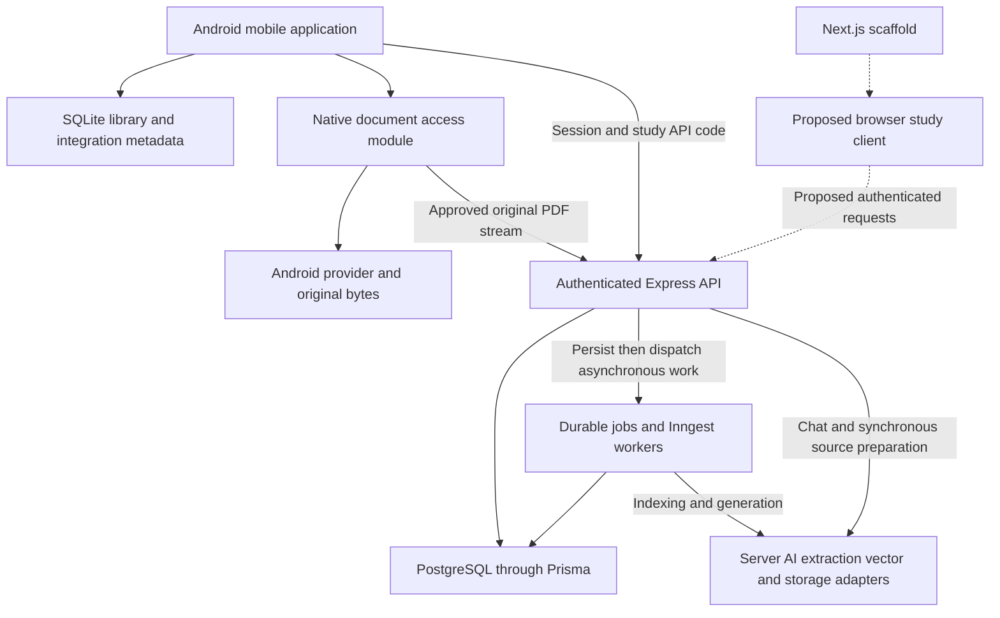
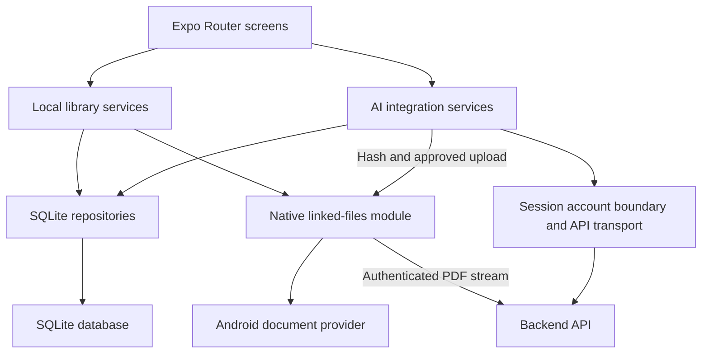
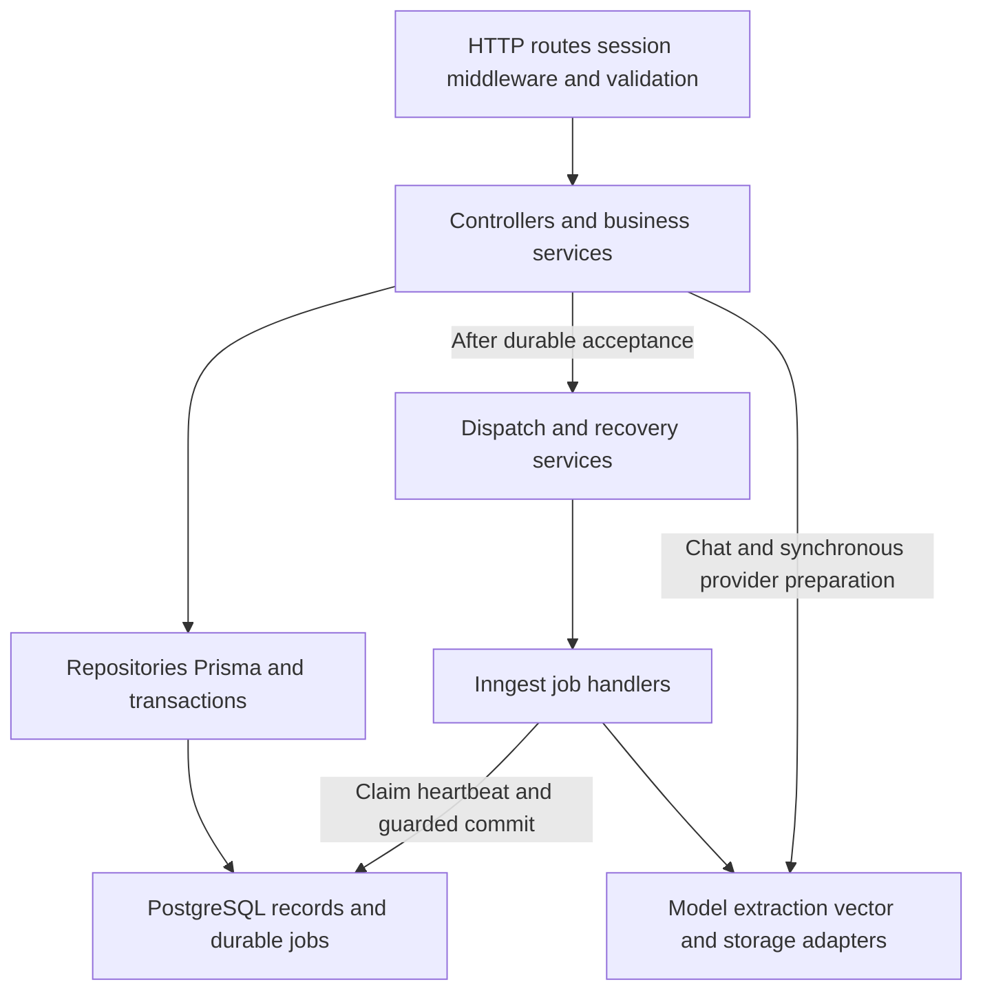
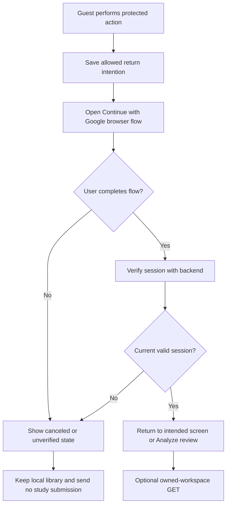
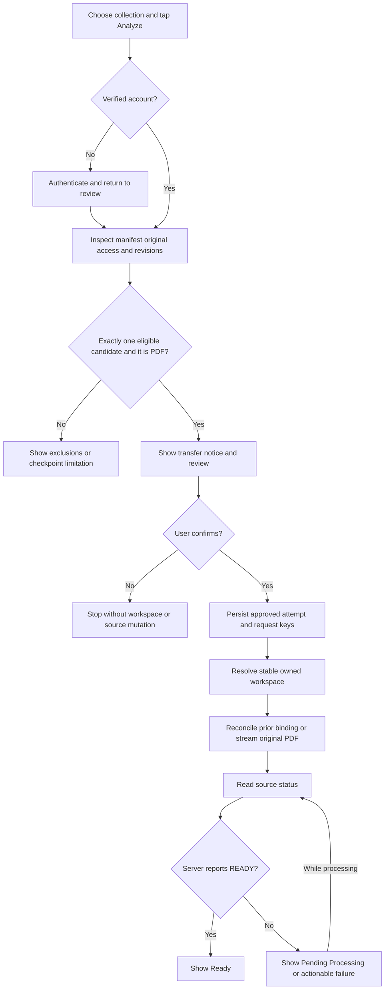
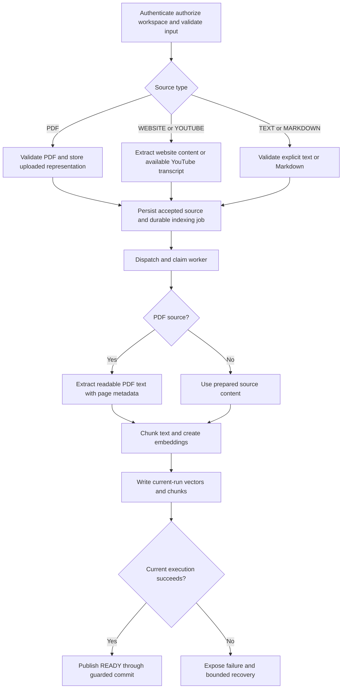
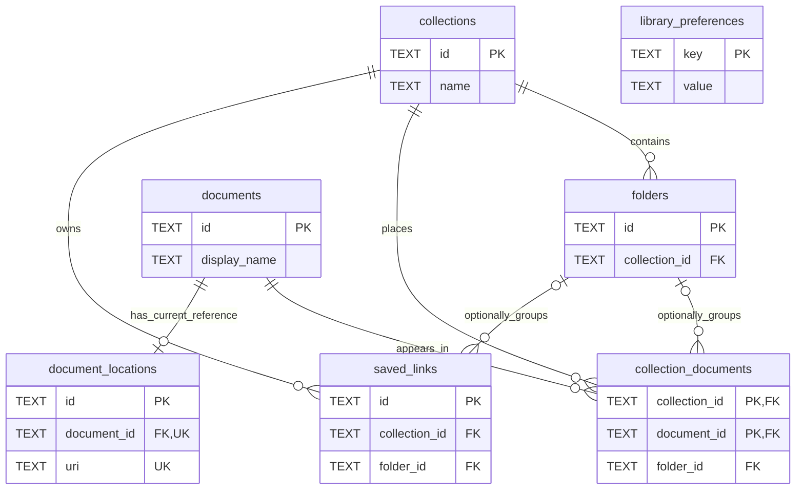
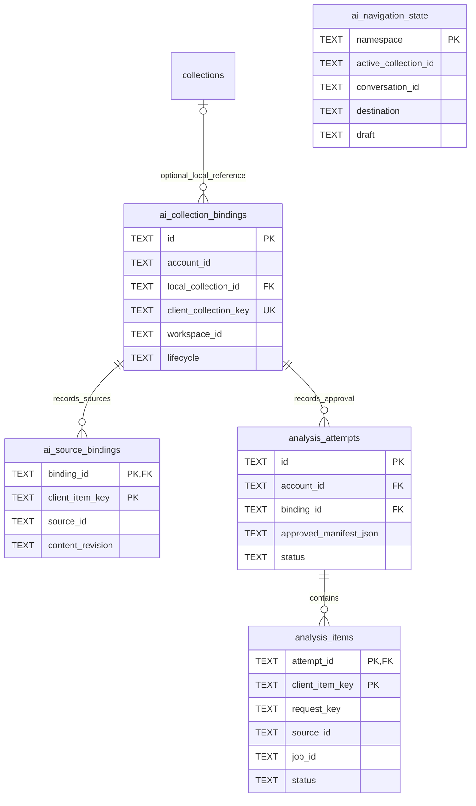
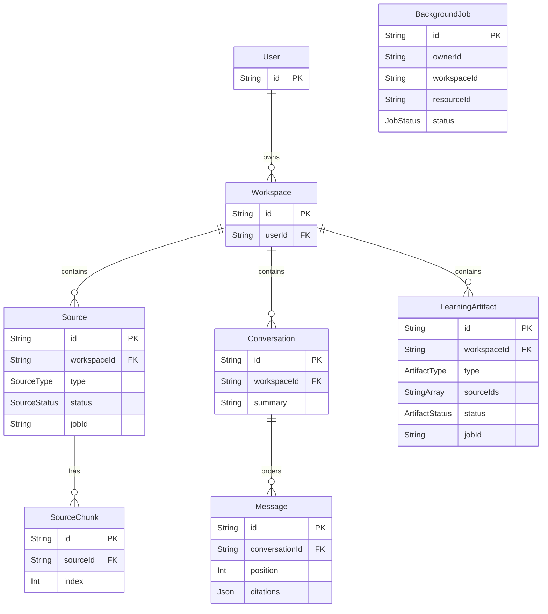
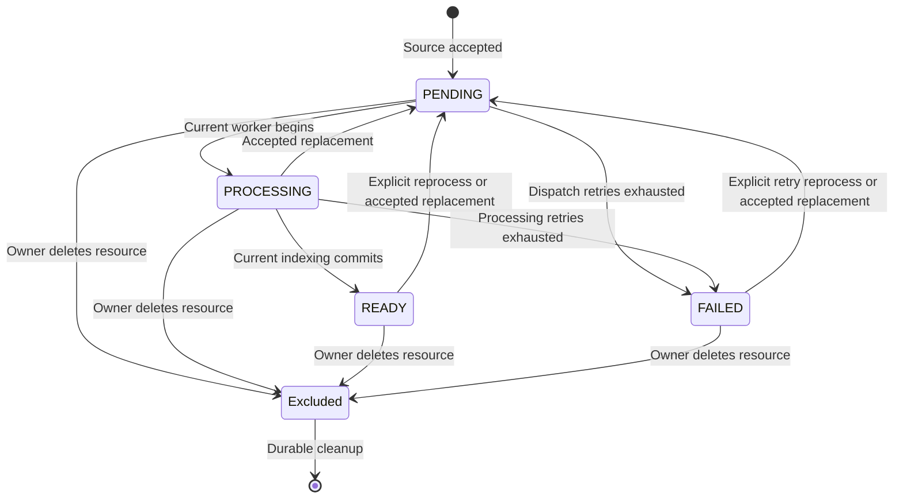

# Tsumugu: Missing Content, Replacements, Code Listings and Diagram Placement

**Read-only review date:** 17 November 2026  
**Report being amended:** `Project Report/Report Build Till Now.pdf`  
**Purpose:** amend the existing report, not replace it with another full report.  
**Write boundary:** the original audit wrote only this Markdown file. At the user's subsequent request, seven selected PNGs were moved unchanged into `Missing-Content/diagrams`, and this guide's paths were updated.

## How to use this guide

- Keep existing project-relevant content unless a replacement or removal is explicitly identified below.
- **REPLACE** means remove the identified passage and use the supplied report text. **ADD** means insert new material without repeating existing explanations.
- Editorial directions, evidence paths and review warnings are for the editor. Text under **Report text** is suitable for the report.
- Page anchors refer to the **original 84-page `Report Build Till Now.pdf`**, not any other draft. `PDF page` means the viewer's physical page; `printed page` means the number printed on that page. In its main body, PDF page = printed page + 12.
- Final page numbers will change after insertion. Use section headings as the durable anchors and regenerate contents, tables and figure lists at the end.
- Current source code establishes implementation, not successful live execution. Historical test notes and earlier-agent accounts are attributed separately throughout this guide.
- Proposed diagrams below are representations of inspected code/design, not execution traces. Dashed connections mean **proposed integration**, not merely “not tested.”

---

# 1. Review findings and which earlier material to reuse

## 1.1 Files reviewed

| Material | Finding and recommended use |
|---|---|
| `Project Report/Report Build Till Now.pdf` | Primary baseline. Preserve its eight-chapter structure. It has outdated implementation descriptions, an unrelated financial-management passage, missing technical detail and inconsistent contents/page entries. |
| `Tsumugu Report Pages Numbering Fixed.docx` and `.pdf` | Useful formatting/reference material, not an authoritative technical update. The financial-management passage remains. |
| `Tsumugu Full Project Report Review Draft.docx` | Adds useful research comparison, architecture and evidence sections, but includes `TBD` entries, the financial passage, and an obsolete complete-schema description. |
| `Tsumugu Full Project Report Review Draft.pdf` | **Exactly the same file bytes as `Tsumugu Report Pages Numbering Fixed.pdf`**, confirmed by SHA-256. Do not assume it exports the current Full DOCX. Both PDFs have 86 pages. |
| `Tsumugu Expanded Project Report Review Draft.docx` and `.pdf` | Best earlier source of supplementary prose, but not ready to paste wholesale. The 94-page PDF retains the financial passage and describes seven tables as the current schema. Its device observations originate in an earlier agent's account. |
| `Tsumugu Major Project Report Review Draft.docx` | Much shorter, reorganized seven-chapter outline. It is not a missing-content-only patch to the current eight-chapter report. |
| `Missing Content and Diagrams/Tsumugu Missing Content Code and Diagrams.docx` | Useful technical supplement. Reuse its factual material selectively, with the corrections below. It still omits formal ER cardinalities, mathematical analysis and several important API distinctions. |
| `Missing Content and Diagrams/Tsumugu Architecture and Workflow Diagrams.zip` | Contains the ten numbered PNGs also present in its `diagrams` folder. Do not insert both ZIP-extracted and folder versions. |
| `report_figures.py` and `Project Report/report_figures` | Five older diagrams. File linking remains useful; local ER is only a simplified version-2 view. The arrow legend differs from the newer diagram set. |
| `report_build.py` | Generates the short reorganized draft; some implementation/status text is historical. Do not run it to amend the existing report. |
| `long_report_build.py` | Reconstructs substantial report text from the baseline PDF and inserts material, but carries over unwanted prose and hard-codes contents/figure page numbers. It also shortens one code listing's error text. |
| `build_missing_supplement.py` | Generates the ten PNGs and supplement. Its fixed six-box layout makes architectural dependencies look like one serial workflow. Source snippets are also line-wrapped for Word, so use the exact listings in this guide instead. |
| `Project Report Instructions/Project Preparation Guidelines.pdf` | Primary formatting and front-matter rules. |
| `Project Report Instructions/List of chapters.docx` | Requires a 5–10-item literature review, methodology with architecture/workflow and mathematics, actual results/environment, conclusion/impact/limitations, Appendix 1 algorithms and complete references. |
| `Project Report Instructions/Chapter Format.docx` | Railway-ticket-checker example. Follow its structural pattern only. Do not import ticket booking, QR validation, wallets or transaction-management claims. |
| `Project Report Instructions/Final Project sample.docx` | Front matter and formatting sample. Its student names, date, department particulars and project designation are examples, not project evidence. |
| `Project Report Instructions/Internal Project Evalution Sheet.docx` | Evaluation form, not evidence of a completed demonstration, publication, deployment or examiner score. |

**Evidence priority:** current implementation and migrations → specific verification notes → current individual task entries → older summaries/presentations. `requirement.md` states intended scope; some of its inspection-snapshot gaps have since been implemented. A checked task or old report does not substitute for a live result.

## 1.2 Important technical corrections

1. **Local organization is not cloud synchronization.** Linking files, saving URLs, opening AI or signing in does not upload the library.
2. **Current mobile execution is a one-PDF checkpoint.** Required scope includes multiple eligible PDFs and saved website/YouTube URLs, but the submission service currently rejects a candidate set other than exactly one PDF. URL API clients do not prove URL submission is connected.
3. **The backend already implements all six artifact types:** `SUMMARY`, `TAKEAWAYS`, `FLASHCARDS`, `QUIZ`, `MINDMAP`, `REPORT`. Mobile/web integration is a separate incomplete layer.
4. **PYQ answering is a collection-chat use case**, not a seventh artifact or dedicated matching product in the confirmed first version.
5. **Incoming Android sharing is not the same as outgoing Share or SAF selection.** Current original-file linking uses the Android document picker/native adapter. Incoming share-target reception is not established as a completed, accepted flow.
6. **Current SQLite migrations define 12 application tables:** seven library tables plus five AI-integration tables. Do not call the seven-table illustration the entire current database.
7. **An Android `content://` URI is an opaque access reference.** A hash identifies a content revision; it does not grant file access or replace the URI.
8. **The web repository is a scaffold**, not a completed AI dashboard. It has providers and components, while study routes and backend integration remain proposed.
9. **Chat and artifact generation use different context strategies.** Chat retrieves top-six vector candidates and filters them. Artifacts gather selected READY-source text with a 120,000-character budget.
10. **Live Google login and a zero-workspace read are only reported by the earlier draft/supplement.** The mobile verification document still marks phone acceptance pending. Retain that attribution unless primary screenshots/logs are attached; do not upgrade it to an independently verified result.

---

# 2. Exactly which diagram goes where

## 2.1 Numbered diagram placement plan

Use the following proposed figure numbers consistently. They are final-caption suggestions, not fixed page allocations. Put captions **below** figures and mention each figure in the immediately preceding paragraph.

`U/` below means `Missing-Content/diagrams/` (selected PNGs moved here at the user's request).  
`D/` means `Project Report/Missing Content and Diagrams/diagrams/` (superseded PNGs retained for reference).  
`F/` means `Project Report/report_figures/` (older alternatives retained for reference).

Selected assets: [original-document linking](diagrams/file_workflow.png), [mobile Analyze](diagrams/03_mobile_workflow.png), [backend chat](diagrams/06_backend_chat.png), [web architecture](diagrams/07_web_architecture.png), [proposed web workflow](diagrams/08_web_workflow.png), [client connection](diagrams/09_client_connection.png), and [artifact workflow](diagrams/10_artifact_workflow.png). Corrected Mermaid replacements remain embedded in §8.

| Figure | Existing file or replacement | Exact report location | Decision and caption |
|---|---|---|---|
| **4.1** | `D/01_combined_architecture.png` | New **4.3 System Architecture**, after existing 4.2.9 and before the existing chapter conclusion; anchor PDF pp. 47–49, printed pp. 35–37 | Prefer corrected Mermaid in §8.1. Caption: **Tsumugu system boundaries and present versus proposed client connections.** The PNG omits synchronous API-to-provider calls and includes an uncorroborated phone-observed footnote. |
| **4.2** | `D/02_mobile_architecture.png` | New **4.4 Mobile Architecture**, after 4.3 | Prefer corrected Mermaid in §8.2. Caption: **Mobile screens, local services, authenticated transport and native document access.** Its drawn arrows include a misleading upward Backend→Session/API arrow. |
| **4.3** | `D/04_backend_architecture.png` | New **4.5 Backend Architecture**, after 4.4 | Prefer corrected Mermaid in §8.3. Caption: **Backend request handling, durable persistence and asynchronous workers.** Repositories are not a worker-execution stage; synchronous chat also calls provider adapters. |
| **4.4** | `U/file_workflow.png` | New **4.6 Original-Document Linking**, after 4.5 | Use existing PNG. Caption: **Original-document linking with native access checks and transactional metadata.** Explain rollback and placement-only unlink in the text. |
| **4.5** | `F/auth_workflow.png` | New **4.7 Authentication and Account Boundaries**, after 4.6 | Use its conceptual sequence only if its embedded “Phone observation” footer is corrected/qualified; otherwise use §8.4. Caption: **Google sign-in, session verification and protected read; device outcomes require attributed evidence.** |
| **4.6** | `U/03_mobile_workflow.png` | New **4.8 Explicit Analyze Workflow**, after 4.7 | Usable as a high-level workflow with the one-PDF limitation in adjacent text. Better decision/cancel coverage is in §8.5. Caption: **Explicit-consent one-PDF Analyze checkpoint; live end-to-end acceptance pending.** |
| **4.7** | `D/05_backend_ingestion.png` | New **4.9 Source Ingestion and Indexing**, after 4.8 | Replace with §8.6. Caption: **Type-specific source preparation followed by asynchronous extraction/indexing.** Website/transcript extraction occurs before acceptance; the old PNG places it all after job creation. |
| **4.8** | `U/06_backend_chat.png` | New **4.10 Grounded Chat**, after 4.9 | Use existing PNG as a high-level diagram. Caption: **Workspace-scoped retrieval, streamed answers and completed-message persistence.** Its insufficient-evidence statement describes intended prompt policy, not guaranteed model correctness. |
| **4.9** | `U/10_artifact_workflow.png` | New **4.11 Learning Artifact Generation**, after 4.10 | Use existing PNG. Caption: **Asynchronous generation and validation of six learning-artifact types.** Mention full selected-source context budget, not top-six retrieval. |
| **4.10** | `U/07_web_architecture.png` | New **4.12 Web Foundation and Proposed Integration**, after 4.11 | Use existing PNG with explicit present/proposed legend. Caption: **Existing Next.js foundation and proposed protected study interfaces.** Do not present it as a deployed client. |
| **4.11** | `U/09_client_connection.png` | New **4.13 Cross-Client Data Boundary**, after 4.12 | Use as a relationship/dependency diagram, not a strict timeline. Caption: **Explicit mobile submission and proposed browser access to shared server records.** Browser requests go to the API, not directly to PostgreSQL. |
| **5.1** | `F/local_er.png` | Replace/expand **5.3.2 Local Metadata Management**, PDF p. 51, printed p. 39 | Prefer actual-cardinality ER in §8.7. Caption: **Core local-library ER model.** Old PNG omits cardinalities, folder constraints and integration tables. |
| **5.2** | No adequate existing PNG | Add **5.3.3 Account-Scoped AI Integration Data**, immediately after 5.3.2 | Use §8.8. Caption: **Local collection bindings, approved attempts and submission items.** |
| **5.3** | No adequate existing PNG | Add **5.3.4 Server Data and Ownership**, after 5.3.3 | Use §8.9. Caption: **Core server entities and workspace ownership.** This is a selected-entity ER, not the entire auth/integration schema. |
| **5.4** | No existing state diagram | Add **5.8.6 Source Lifecycle**, before current 5.9 conclusion, PDF p. 58, printed p. 46 | Use §8.10. Caption: **Simplified source lifecycle with explicit reprocessing.** Do not label it a complete background-job state machine. |
| **8.1** | `U/08_web_workflow.png` | Expand **8.3 Future Enhancements**, PDF pp. 77–78, printed pp. 65–66 | Use existing PNG. Caption: **Proposed browser study workflow; not an implementation result.** |

**Conclusion location in Chapter 4:** rename existing **4.3 Conclusion** to **4.14 Conclusion**, after these additions. Do not leave a conclusion followed by most of the chapter's architecture.

## 2.2 What to do with the remaining older diagrams

| Older file | Action |
|---|---|
| `F/architecture.png` | Omit if Figure 4.1 is used. It duplicates the boundary explanation, omits the web scope and uses dashed arrows to mean unverified acceptance rather than proposed code. |
| `F/analysis_workflow.png` | Omit if Figure 4.6 is used. It is a shorter duplicate with weaker checkpoint detail. |
| `F/local_er.png` | At most retain as a simplified **version-2 core-library view**, never as the complete current schema. Figure 5.1 is preferable. |
| `F/auth_workflow.png` | Its workflow is useful; its embedded observation needs primary evidence or an explicit “earlier draft reports” qualification. Figure 4.5 Mermaid avoids the unsupported footer. |
| `U/file_workflow.png` | Moved to `Missing-Content/diagrams`; retain as Figure 4.4. |

Do not paste every available diagram merely to increase page count. The diagrams above have different responsibilities; short duplicate architecture/Analyze versions add little.

## 2.3 Screenshots are different from workflow diagrams

The baseline figure list names Home, Collection Dashboard, AI Chat and import screenshots, but list entries do not establish functioning screens. Use actual screenshots with build/date and state labels, not design-inspiration images as implementation proof.

- Put Home, collection creation, folder and saved-resource screenshots beside the corresponding **6.3.2–6.3.5** implementation descriptions.
- Put account/session and Analyze review/progress screenshots in the implementation evidence section, with any result cross-referenced in Chapter 7.
- A placeholder AI chat or artifact screen must be captioned **UI prototype—not backend-connected**, not “working AI answer.”
- Do not caption a SAF picker as an incoming Android share-sheet workflow.
- Keep screenshot numbering separate from the technical diagrams: for example **6.1, 6.2, …**. Rebuild the old figure list rather than preserving inaccurate entries such as `5.7.1 Android Share-Sheet Import Workflow`.

---

# 3. Required replacements in the existing report

## R1 — Project name and unsupported administrative substitutions

**Locations:** cover PDF p. 1; supervisor approval p. 4; certificate p. 5.

Replace `TSUGUMU` / `Tsugumu` with **TSUMUGU** / **Tsumugu**.

Do **not** automatically copy “Major Project,” “Project-II,” “Academic Session 2026–2027,” or a new submission month from another draft. The baseline says Project-I and May 2026, whereas later development notes are from November 2026. Confirm the official project designation, session, semester and submission date with the guide. The approval and acknowledgements also name different HoDs; verify the authorized signatories instead of guessing.

## R2 — Replace the abstract

**Location:** PDF pp. 6–7, printed iv–v. Replace only the abstract, not acknowledgements, keywords or contents.

**Report text:**

Tsumugu is an Android-first study-resource organization project that connects a local academic library with a server-side AI study service. Students often receive notes, documents and links through unrelated applications, making subject-wise retrieval difficult. Tsumugu groups these resources into collections and one-level folders while preserving references to original documents through Android document-provider access. Basic local organization remains available without sign-in.

The mobile application uses React Native, Expo and SQLite. A separate Express and TypeScript backend uses PostgreSQL through Prisma to manage authenticated workspaces, submitted sources, conversations, learning artifacts and durable background jobs. Its retrieval-augmented generation workflow extracts source content, creates embeddings, retrieves relevant workspace passages and supplies them to a language model with source references. Supported artifact types are summaries, takeaways, flashcards, quizzes, mind maps and reports.

The current implementation includes local-library services, authentication infrastructure and a limited one-PDF Analyze path with explicit submission consent and server-derived readiness. Live phone-to-provider-to-backend acceptance remains pending. Mobile chat and artifact integration, broader Analyze inputs and the browser study application also require further work. Repository verification notes record automated checks, but these are distinguished from complete-system and student-use evaluation.

The project establishes an architecture for organizing study material and applying source-aware learning tools without treating local file references as cloud synchronization. Further integration and reproducible device testing are needed before claims of educational improvement, performance or complete application readiness can be made.

**Keywords:** Android; study-resource organization; SQLite; original-document access; retrieval-augmented generation; source-grounded learning.

## R3 — Remove unrelated financial-management text

**Location:** 1.10, PDF p. 17, printed p. 5. Remove the passage beginning `User Experience Understanding: We understood...` through `a smooth financial management experience for all types of users.` It also survives in the longer generated drafts.

Replace item 5 with:

**Report text:**

**5. Document-processing limits:** The backend extracts readable PDF text, website content and available YouTube transcripts. Scanned or image-only PDFs require OCR that is not implemented in the current pipeline. Complex layouts, missing transcripts and incomplete extraction can reduce source coverage and answer quality.

Also replace 1.10 item 2 with:

**2. Original-file availability:** A stored document URI does not guarantee continuing access. External deletion, provider changes or revoked grants can make a document unavailable. A rename or move does not necessarily invalidate every provider URI; the application must check access rather than infer availability from the display name.

## R4 — Correct file-reference and share-sheet claims wherever repeated

**Affected anchors:** 1.7 points 3 and 5 (PDF p. 15); 1.9 point 4 (p. 17); technical product analysis 3.6.4 (p. 34); 4.2.2 and 4.2.5 (pp. 44–45); 5.1 resource-import module (p. 50); 5.7/5.7.1 (pp. 56–57); 6.2.4 (p. 61); 6.3.4 (pp. 64–65); related Chapter 7 and Chapter 8 summaries.

Replace claims such as `Tsumugu uses native share-sheet integration to receive supported resources` and `share-sheet import ... tested internally` with:

**Report text:**

The implemented original-document workflow uses Android's document picker and a native document-access adapter. It records an accessible original `content://` URI, metadata and a collection placement without deliberately copying the original into the library. Incoming share-target reception from other applications remains a separate implementation and device-acceptance task. Outgoing View, Share and Edit actions use compatible installed applications and do not prove incoming-share support.

Replace `paths or content hashes` when describing how an original is reopened with:

**Report text:**

Original access uses the saved Android content URI together with currently available permission grants. A content hash may identify a submitted PDF revision, but it cannot reopen the document or restore a lost permission.

**Specific heading changes:**

- 5.7.1 → **Document-Picker Linking and Planned Incoming Sharing**. Replace its incoming-share example and internal-pass claim with the two paragraphs above.
- 6.2.4 → **Android Intents and Planned Incoming Sharing**. Use the first paragraph above.
- 6.3.4 → **Original-Document Linking and Provider Actions**. Replace its sharing-integration activity list with §4.6 below.
- 8.1.3 → **Successful Original-Document Linking**: “A selected readable original must be linked to the intended collection, remain accessible where the provider permits, and report loss of access clearly. Incoming-share reception requires its own future acceptance cases.”

Preserve share-sheet discussion that is explicitly about a **future requirement**, but do not describe that requirement as a current result.

## R5 — Repair objectives and extend the incomplete scope

**Location:** 1.7 point 7, PDF p. 15, printed p. 3.

**Replacement report text:**

**7. Collection-specific AI context:** Submitted sources, conversations and generated artifacts belong to the selected account-owned workspace. A collection's AI context must not include unrelated material from another collection.

**Location:** 1.9, after its existing four scope items, PDF p. 17. Add:

**5. Explicit AI submission:** The required Analyze workflow submits eligible PDFs and saved website/YouTube URLs only after authentication and confirmation. The current mobile checkpoint implements exactly one PDF; broader submission remains incomplete.

**6. Server study service:** The backend provides workspace-owned sources, processing jobs, grounded chat, saved conversation history and six learning-artifact types.

**7. Web study access:** The intended browser client manages server workspaces, submitted sources, chat and artifacts. Its study workflows remain proposed; phone-only folders and original-document permissions are not synchronized.

**8. Source updates and deletion:** Local unlinking, original deletion and remote deletion are separate operations. Later source changes require explicit reviewed submission rather than silent reindexing.

## R6 — Replace the presentation-era status table

**Location:** 3.6.2, PDF p. 33, printed p. 21. Keep its warning against invented performance figures. Replace the old `Component / Status reported in presentation` table with:

**Table 3.1 — Implementation status and evidence boundaries**

| Component | Current source/documentation status | Remaining boundary |
|---|---|---|
| Local library | Collections, flat folders, original placements, typed saved URLs, search, pins and sorting implemented | Provider/UI acceptance on representative phones |
| Original-document access | Native access checks and external View/Share/Edit; unlink/move and confirmed original deletion | Provider variation, permission persistence and interruption cases |
| Authentication | Google-only session infrastructure, secure storage, account guards and protected transport | Live OAuth/device matrix; earlier draft reports limited phone observations |
| Mobile Analyze | Review, consent, stable identity, native original-PDF upload and status reads connected for one PDF | Actual source reaches READY; retries/restart; batches and saved URLs |
| Backend ingestion/chat | Authenticated source APIs, indexing, workspace retrieval, streamed chat and persisted history implemented | Live providers, factuality and integrated client acceptance |
| Backend artifacts | All six artifact types and validation implemented | Mobile/web generation and saved-result interfaces |
| Web | Next.js starter route, theme/query providers and UI components | Protected study routes and backend connection |
| Incoming Android sharing | Future incoming-share workflow | Implementation and share-target acceptance |

Apply this status distinction to 3.6.1, 3.6.5, 3.7.2, 3.8 and 3.9 where all generation is otherwise described as merely planned. Do not replace one blanket statement with another blanket “everything is complete.”

## R7 — Replace the generic conceptual database description

**Location:** 5.3.2, PDF p. 51, printed p. 39. Replace “A conceptual database structure may contain…” and its three-entity table with §5.1–§5.3 below. Retain 5.3.1's general explanation of metadata versus document content.

If importing the Expanded/Full draft, replace “These seven tables are the current local schema…” with:

**Report text:**

The seven core-library tables describe local organization. Migration 003 adds five account-scoped AI-integration tables, bringing the inspected application schema to 12 tables. Authentication secrets are not stored in these library tables, and completed conversations and generated artifacts remain authoritative on the server.

## R8 — Replace the incomplete AI-feature list

**Location:** 5.5.3, PDF p. 54, printed p. 42. Rename it **Learning Artifacts and Client Integration Status** and replace its list/closing sentence with:

**Report text:**

The backend implements six learning-artifact types: summary, takeaways, flashcards, quiz, mind map and report. Their output contracts are described in the implementation chapter. Server support does not establish completed mobile or browser study flows; those clients still require generation, progress, error and saved-output integration.

Previous-year questions are answered through the collection's grounded chat workflow. A separate PYQ artifact or automatic PYQ-to-source matching product is not part of the confirmed first version. Sharing an entire collection with third-party chat products is outside the confirmed first-version scope and should be retained only as an explicitly optional future idea.

## R9 — Replace unspecified model/provider instructions

**Locations:** end of 2.5 software resources (PDF p. 24); end of 4.2.8 (p. 46); end of 6.2.7 (p. 61).

Replace instructions such as `The exact model and provider should be recorded...` with:

**Report text:**

The inspected backend uses OpenAI through the AI SDK. Its default chat model is `gpt-4o-mini`, with `gpt-4o` also allowed, and its embedding model is `text-embedding-3-small` with 1,536 dimensions. Pinecone stores searchable vectors, Cloudinary stores uploaded PDF representations, and Inngest executes recoverable background work. These are current source configuration values, not measured optimum settings or a guarantee of live provider availability.

Do not add Anthropic or Gemini as current runtime providers merely because an older bibliography lists their documentation.

## R10 — Remove drafting instructions and fix broken transitions

- **PDF p. 41, printed p. 29:** remove `Important for your final submission:...` and `Also, your presentation reports...`. These are editor instructions, not literature-review content.
- **PDF pp. 46, 54, 70 and 74:** remove standalone `Tsumugu Progress Presentation.pdf` drafting remnants. If a factual claim still needs the presentation, use a numbered bibliography citation with a date/status qualification.
- **PDF p. 81:** remove `Use the following references as a starting list...` and use the finalized bibliography in §10.
- **5.4.2**, ending `This two-level organizational approach provides a more detailed structure than storing every resource`: complete it with “in a single undifferentiated list. Folders are flat children of a collection rather than recursively nested directories.”
- **5.5.4**, ending `without`: complete it with “requiring an account for basic local organization. Protected AI operations additionally require a current server-verified session and workspace ownership.”
- **5.7.2**, ending `helps establish a more`: complete it with “permission-aware document workflow. Restoring metadata alone does not restore original bytes or Android access grants.”
- **6.3.7**, ending `within the application's`: complete it with “collection-specific study interface. The current one-PDF submission checkpoint does not yet complete chat, history or artifact integration.”
- **7.6**, ending `differences in resource-sharing habits and`: complete it with “provider behavior. No participant count or usability outcome is claimed without a recorded study.”
- Keep only one instance of the repeated **3.5 Market Review** opening across PDF pp. 31–32 and the repeated **7.9 Conclusion** across pp. 75–76. Do not delete distinct substantive content.

## R11 — Correct chapter names and navigation

- Contents calls Chapter 6 **INTRODUCTION**; the chapter body is **IMPLEMENTATION**. Use **CHAPTER 6: IMPLEMENTATION** in both.
- Change `CHATPTER 7` to **CHAPTER 7**. “TESTING AND RESULTS” is a useful title once §7 below is added.
- Preserve the eight-chapter organization; the required “Problem Objective,” “Methodology,” and “Results” subjects can be covered by the existing chapters rather than renaming/reordering the whole report.
- The current contents page numbers do not consistently match the body; do not manually reuse them after insertion.

---

# 4. Missing methodology content — add in Chapter 4

**Insertion:** after existing 4.2.9, before the current 4.3 conclusion. Use the following new section numbers. Figure definitions/assets are in §2 and §8 of this guide.

## 4.3 System Architecture

**Report text:**

Tsumugu separates local organization from remote study processing. The Android application owns collections, folders, saved links and references to original documents. Android document providers retain the original bytes and control access. The backend owns authenticated workspaces, submitted sources, processing jobs, saved conversations and generated artifacts. Figure 4.1 shows these boundaries and the proposed browser connection.

One parent mobile collection corresponds to one backend AI workspace for an account. Child folders remain local organizational units and do not become separate workspaces. A stable binding records the server workspace ID; a mutable collection name is only a display title, not a safe identity key. Signing in is not a backup operation and does not authorize uploading every file.

**Insert Figure 4.1 here.**

## 4.4 Mobile Architecture

**Report text:**

The mobile application uses Expo Router for screens and navigation, service modules for workflows, repositories for SQLite access, and a native Android module for original-document operations. Authentication uses Better Auth integration and secure credential storage. Protected API operations use a current account boundary so a late response from a previous account is rejected before being committed to the new account's state.

The native module inspects URI access, opens provider streams, performs original-file actions and supplies the PDF hashing/upload capability. A development build is required for this native functionality; a successful JavaScript export alone does not validate it. Figure 4.2 separates local services, protected transport and native access.

**Insert Figure 4.2 here.**

## 4.5 Backend Architecture

**Report text:**

The backend is an Express 5 and TypeScript application. Routes and middleware establish the authenticated request context; controllers and validators check inputs; services enforce ownership and workflow rules; repositories use Prisma and PostgreSQL. Provider adapters isolate model, vector, extraction and storage services. Bun supports development/package workflows, while the production image runs compiled JavaScript with Node.js.

Durable job records are stored with accepted asynchronous work before dispatch. Inngest invokes workers, and recovery logic reconciles missed delivery and expired execution leases. Chat streaming also uses providers during request processing, so not every provider operation is a background job. Figure 4.3 shows request and worker paths separately.

**Insert Figure 4.3 here.**

## 4.6 Original-Document Linking

**Report text:**

The user selects an original document through Android's picker and chooses a collection destination. The native adapter checks currently available access before metadata is committed. A SQLite transaction creates or reuses the document identity, saves the current original URI and adds the collection placement. Native provider calls occur outside the database transaction. If persistence fails, the application preserves prior records and releases only a newly unused grant where appropriate.

Exact original URIs, not equal filenames, determine reference reuse. View, Share and Edit launch compatible external applications; successful launch does not prove that an external edit or share completed. Move changes a placement, and Unlink removes only that placement. Deleting the original is a separate confirmed provider action that can affect every placement referencing it. Figure 4.4 summarizes linking.

**Insert Figure 4.4 here.**

## 4.7 Authentication and Account Boundaries

**Report text:**

Continue with Google is the sole account creation/sign-in method. A successful browser return does not itself authorize study operations: the mobile app verifies the current server session. A cached identity is a display hint, not an authorization grant. Protected backend routes require a session, and services additionally check ownership of the requested workspace and nested resource.

Account changes invalidate protected requests and account-specific state while preserving the local library and original files. A protected workspace-list read checks connectivity without creating a workspace or submitting a source. Figure 4.5 illustrates this distinction. Phone results are reported separately from the authentication design and automated tests.

**Insert Figure 4.5 here.**

## 4.8 Explicit Analyze Workflow

**Report text:**

Analyze is an explicit transfer decision, not an automatic consequence of local linking or sign-in. The app prepares a collection manifest, checks source accessibility and reports exclusions. The user can cancel before confirmation without creating a workspace or uploading a source. The connected checkpoint currently permits exactly one eligible PDF and blocks batches and saved-URL candidates. The broader required PDF-plus-URL workflow remains future integration work.

After approval, the application persists the attempt and request identities, resolves or reuses the owned collection workspace, reconciles prior server bindings and streams the original PDF. A hash identifies the approved content revision. A lost response is reconciled before a new request is created; unchanged accepted sources should be reused rather than blindly uploaded again.

An upload response means acceptance, not successful indexing. Source status is read from the backend before the collection is shown as Ready. Changed existing sources are currently rejected for a later reviewed update flow. Figure 4.6 represents this checkpoint; it does not establish live phone-to-READY acceptance.

**Insert Figure 4.6 here.**

## 4.9 Source Ingestion and Indexing

**Report text:**

The backend accepts PDF, website, YouTube, text and Markdown sources through type-specific endpoints. PDF upload stores a server representation before worker extraction. Website extraction and YouTube transcript retrieval prepare content before source acceptance; workers subsequently chunk and index it. Text and Markdown are explicit API content inputs, not additional mobile picker upload formats. Figure 4.7 distinguishes these paths.

For indexed work, the worker divides readable content into bounded chunks, generates embeddings and writes source/chunk metadata to the vector index. PDF page information is retained where available. Current defaults are a 1,000-character chunk size, 100-character overlap and 1,536-dimensional embeddings. Job/run identity checks prevent obsolete processing results from being used as the current source version.

The upload limit is 10 MiB for a single PDF. Scanned PDFs have no OCR fallback in the current pipeline, and YouTube support depends on available captions/transcripts rather than arbitrary audio transcription. A failed extraction must not be reported as Ready.

**Insert Figure 4.7 here.**

## 4.10 Grounded Chat

**Report text:**

Chat is scoped to the authenticated account's selected workspace and requested conversation. The service uses persisted ordered history and that conversation's summary. It embeds the question, queries the workspace vector namespace and checks retrieved candidates against current READY sources. Deleted sources and obsolete job/index runs are excluded. Figure 4.8 shows this process.

The current configuration requests six vector candidates and excludes scores below 0.35. The system prompt treats source excerpts as untrusted data, asks for source/page references and instructs the model to explain insufficient evidence rather than fill gaps with general knowledge. These controls do not guarantee factual correctness. The complete assistant message and citations are saved only after successful stream completion.

Optional outside web search requires explicit enablement and uses separate W-labelled references. Ingesting a saved website URL does not enable later unrestricted web search. Current collection chat does not retrieve or learn account-wide Mem0 memories; separate manual-memory APIs are not collection evidence.

**Insert Figure 4.8 here.**

## 4.11 Learning Artifact Generation

**Report text:**

The backend accepts six artifact types: summary, takeaways, flashcards, quiz, mind map and report. It validates the owned workspace and selected usable sources, stores an artifact and durable job, and returns identifiers before generation completes. Figure 4.9 shows generation and validation.

Unlike chat's top-six retrieval, artifact generation gathers selected READY-source text up to a 120,000-character budget. Metadata records contributing sources and truncation. Generated content is validated before READY is published: required text must be nonblank, quiz answer indexes must refer to existing options, and mind-map identifiers/edges must be internally consistent. Structural validity is not proof that the learning content is factually correct or comprehensive.

**Insert Figure 4.9 here.**

## 4.12 Web Foundation and Proposed Integration

**Report text:**

The browser repository currently contains a Next.js App Router starter page, reusable UI components, a theme provider and a React Query provider. It does not yet provide the protected study workflow. Figure 4.10 distinguishes these existing foundations from proposed Google sign-in, workspace/source management, streaming chat, history and artifact interfaces.

The intended web client uses the same authenticated backend and server record IDs. It must isolate account/workspace caches, display processing failures and preserve citation/history semantics. Browser access does not grant access to Android original URIs or synchronize phone folders.

**Insert Figure 4.10 here.**

## 4.13 Cross-Client Data Boundary

**Report text:**

Local-to-server bindings connect approved mobile study work to owned server records. Once browser integration is completed, the same account can request those server workspaces, conversations and artifacts. Figure 4.11 expresses this dependency, not automatic phone-library synchronization or a mandatory mobile-before-web timeline.

Deleting a local collection or unlinking a document does not silently issue a backend deletion. Remote source deletion excludes that source from new retrieval and schedules server cleanup; it does not delete the phone original. Previously generated artifacts may remain as historical outputs when an individual source is removed. Workspace deletion removes its server conversations and artifacts as well.

**Insert Figure 4.11 here.**

## 4.14 Conclusion

Retain the project-relevant portion of the existing Chapter 4 conclusion, shorten repeated research summaries, and ensure it no longer claims incoming-share reception is completed. Put the mathematical subsection below under **4.9.1** and update the contents accordingly.

## 4.9.1 Mathematical Model and Configuration Interpretation

**Report text:**

Let a query embedding be q and a chunk embedding be v, each in R^1536. Their cosine similarity is:

**s(q, v) = (q · v) / (||q|| ||v||).**  
*Equation (4.1): cosine similarity for nonzero embedding vectors.*

The application requests the top k = 6 candidates from the active workspace namespace, then keeps candidates whose score is at least τ = 0.35 and whose source/job/run identity is current. Thus:

**R(q, w) = {c ∈ TopK(q, w, 6) : score(c) ≥ 0.35 and LiveReadyCurrent(c, w)}.**  
*Equation (4.2): application-side candidate eligibility.*

Filtering occurs after candidate retrieval, so fewer than six chunks may remain. The threshold is a similarity configuration, not 35% answer accuracy or a probability of correctness.

For a simplified fixed-window model with text length L, chunk bound C = 1,000 and overlap O = 100, the stride is C − O = 900 characters. An approximate chunk-count planning model for nonempty text is:

**N ≈ max(1, ceil((L − O) / (C − O))).**  
*Equation (4.3): approximate fixed-window chunk count.*

The actual splitter respects text boundaries and PDF pages, so this is not an exact prediction of every document's chunk count. Approximate raw embedding-value storage for N vectors is **N × 1,536 × b bytes**, where b is the assumed bytes per numerical component; it excludes text, metadata, index structures and provider overhead. Neither expression is a measured storage benchmark.

These models explain the roles of overlap, embedding dimension and retrieval filtering. They do not establish optimal parameters, latency, retrieval accuracy or student learning outcomes.

**Word formatting:** enter these expressions in the equation editor, keep equation numbers, and refer to them in the surrounding text.

---

# 5. Missing analysis/data content — Chapter 5

## 5.1 Replacement for report section 5.3.2: Local Metadata Management

**Report text:**

The local database separates an original document from its organizational placements. A document can be linked in multiple collections without duplicating its bytes. Within a collection, the composite placement key prevents the same document from being inserted twice. An optional folder determines whether the placement appears at the collection root or inside one flat child folder.

**Table 5.1 — Core local-library tables**

| Table | Role and integrity rule |
|---|---|
| `collections` | Local subject containers, presentation metadata and pin ordering |
| `folders` | Flat children of a collection; destination constraints prevent cross-collection placement |
| `documents` | Original-document identity and file/display metadata |
| `collection_documents` | Placement between collection and document, with optional folder; composite collection/document key |
| `document_locations` | One saved current original URI per document, permission/provider/access state; URI is unique |
| `saved_links` | Typed website/YouTube records, collection and optional folder, canonical URL identity |
| `library_preferences` | Persisted sort/display preferences, not original bytes or server chat history |

New collections create ordinary editable/deletable YouTube and Websites folders transactionally. A link's kind is stored independently of the folder name. SQLite foreign keys, constraints and transactions protect multi-record operations. Figure 5.1 shows the core-library relationships.

**Insert Figure 5.1 from §8.7.**

## 5.2 Add report section 5.3.3: Account-Scoped AI Integration Data

**Report text:**

Migration 003 adds five integration tables without turning the local database into an authoritative chat/artifact store. These tables record account-scoped server identity, explicit approval and recoverable submission state. Figure 5.2 shows the integration relationships.

**Table 5.2 — Local integration tables**

| Table | Purpose |
|---|---|
| `ai_collection_bindings` | Account/local-collection association, stable client collection key, optional workspace ID and lifecycle |
| `ai_source_bindings` | Stable item key, source ID, content revision and observed remote state; survives local item removal |
| `analysis_attempts` | Approved manifest, consent time, account/binding and collection-level attempt state |
| `analysis_items` | Per-item action, request key, expected/target revision, source/job IDs and progress/error state |
| `ai_navigation_state` | Guest/account namespace, selected collection, destination, conversation identity and unsent draft |

The approved manifest is protected against mutation by a database trigger. Local collection deletion clears its local binding reference while retaining the remote identity/lifecycle evidence. Source IDs and workspace IDs are server references, not SQLite foreign keys into a remote database. Future-oriented schema fields do not prove that all update/removal workflows are already connected.

**Insert Figure 5.2 from §8.8.**

## 5.3 Add report section 5.3.4: Server Data and Ownership

**Report text:**

A backend user owns workspaces. Each workspace contains sources, conversations and learning artifacts. Sources have ordered chunks, and conversations have ordered messages with saved citations. Artifact records contain source-ID selections and generation metadata. Figure 5.3 shows this central model.

The server additionally persists mobile workspace/source bindings, idempotent client submissions and background jobs. Background jobs intentionally do not have a cascading parent-resource foreign key because cleanup work must survive resource removal. Some source/job and artifact/source associations are saved identifiers rather than enforced relational foreign keys. These distinctions matter when explaining deletion and recovery.

Phone SQLite metadata, server records, Cloudinary PDF representations and Pinecone vectors are separate stores. Restoring a database row does not restore a deleted original or Android permission.

**Insert Figure 5.3 from §8.9.**

## 5.4 Add report section 5.7.3: Consent, Changes and Deletion Semantics

**Report text:**

| Action | Meaning |
|---|---|
| Save a local document/link | Store organization metadata only; no remote AI submission |
| Move or unlink a placement | Change local organization; preserve the original and unrelated placements |
| Delete a local collection/folder | Remove its local organizational records; not an implicit remote delete |
| Delete original | Separate confirmed provider action affecting access from all placements |
| Analyze | Explicitly approve supported-source transfer and processing |
| Delete remote source | Exclude it from new retrieval and clean up server representations/vectors; leave phone original untouched |
| Delete remote workspace | Remove its server sources, conversations and artifacts; leave local originals untouched |

Required future updates reuse stable source/workspace identities and reconcile changed material only after review. A folder rename or moving an unchanged item inside its parent collection is not a new AI workspace. The current mobile checkpoint does not complete collection-wide replacement/removal orchestration, and the backend does not provide an atomic whole-collection snapshot swap.

## 5.5 Add report section 5.8.6: Source Lifecycle

**Report text:**

Source state is distinct from HTTP acceptance and from background-job state. A source normally begins PENDING, enters PROCESSING, and becomes READY only after successful current-run indexing. Exhausted dispatch can also mark a still-pending source FAILED. Processing failures may be retried internally before exhaustion exposes FAILED and a controlled retry/reprocess path. A deleted source is excluded from retrieval independently of later physical cleanup. Figure 5.4 is a simplified view of this lifecycle.

Background jobs separately use PENDING, DISPATCHED, RUNNING, SUCCEEDED, FAILED and CANCELLED states. A returned source/job ID or successful upload does not mean the source is ready for study.

**Insert Figure 5.4 from §8.10.**

---

# 6. Missing implementation content — Chapter 6

## 6.1 Add tools after current 6.2.7

**Report text:**

**6.2.8 Backend, persistence and workers:** Express and TypeScript implement the API; Prisma accesses PostgreSQL; Inngest executes durable asynchronous work. Source, artifact, conversation and job APIs apply account/workspace authorization.

**6.2.9 Retrieval and external services:** OpenAI supplies embeddings and generation, Pinecone stores workspace vector namespaces, Cloudinary stores submitted PDF representations, Firecrawl prepares website content, and `youtube-transcript` retrieves available captions. Tavily supports explicitly enabled outside search. Provider credentials remain server-side.

**6.2.10 Web foundation:** Next.js and React supply the browser scaffold. Theme and React Query providers are installed, but protected study routes, account-scoped data queries and result interfaces remain to be integrated.

## 6.2 Add 6.3.8: Current Integration Checkpoint

**Report text:**

The connected mobile AI workflow is deliberately constrained to one original PDF. Source code persists approval and request identity before remote work, checks account freshness after awaited responses, reconciles uncertain submissions and reads server source status. Broader Analyze batches, saved URLs, reviewed updates, connected chat/history, six artifact interfaces and remote management remain incomplete. A compiled native development build does not establish phone-provider/backend acceptance.

## 6.3 Add 6.3.9: API Contract and Client States

**Report text:**

The main workspace route prefix is `/api/workspaces/:workspaceId`, abbreviated below as **W**. The table describes coded contracts, not newly observed HTTP responses.

**Table 6.1 — Selected implemented API contracts**

| Operation | Method and route | Success semantics |
|---|---|---|
| List/create/resolve workspaces | `GET/POST /api/workspaces` | 200 list; 201 new workspace; 200 existing mobile binding |
| Read/update/delete workspace | `GET/PATCH/DELETE W` | 200/200/204 |
| Submit text/Markdown | `POST W/sources` | 201 source and durable job |
| Submit PDF | `POST W/sources/upload` | 201 create; mobile reuse/replay can return 200 or saved original response status |
| Import URL | `POST W/sources/import/website` or `/youtube` | Type-specific preparation then accepted source/job; reuse/replay distinctions apply |
| Read source/status | `GET W/sources/:sourceId` | 200 current source state |
| Reconcile mobile identity | `GET W/sources/mobile-bindings` | 200 bindings, including deletion evidence |
| Replace/reprocess source | `PUT W/sources/:sourceId/content`; `POST W/sources/:sourceId/reprocess` | 200 replacement; 202 reprocess with job identity |
| Send chat | `POST W/chat` | AI SDK UI-message stream; `X-Conversation-Id` identifies saved conversation |
| Read saved history | `GET W/conversations/:conversationId/messages` | 200 ordered messages and saved citations |
| List/request artifacts | `GET/POST W/artifacts` | 200 list; 202 accepted artifact/job |
| Read/retry artifact | `GET W/artifacts/:artifactId`; `POST W/artifacts/:artifactId/retry` | 200 state/content; 202 retry |
| Read/retry owned job | `GET /api/jobs/:jobId`; `POST /api/jobs/:jobId/retry` | 200 status; 202 retry |
| Delete source/conversation/artifact | Corresponding `DELETE W/.../:id` | 204, no JSON response body |

Unauthenticated requests return 401; missing or foreign owned resources generally return 404. Invalid input and multipart validation failures return 400, oversized JSON may return 413, idempotency/revision conflicts return 409, and owned deleted mobile binding targets can return 410. Unavailable explicitly requested outside search returns 503. Clients must preserve these distinctions rather than mapping every problem to “upload failed.” An error after streaming starts is a stream failure, not a replacement HTTP response.

The server accepts one PDF multipart `file` up to 10 MiB. Common middleware checks MIME and size; the mobile submission path additionally checks PDF signature bytes and the submitted SHA-256 revision. Do not attribute the stronger mobile checks identically to every legacy upload path.

## 6.4 Add 6.3.10: Artifact Contracts

**Report text:**

| Type | Stored output shape |
|---|---|
| `SUMMARY` | `{ markdown }` |
| `TAKEAWAYS` | `{ items: string[] }` |
| `FLASHCARDS` | `{ cards: [{ front, back }] }` |
| `QUIZ` | `{ questions: [{ question, options, correctIndex, explanation }] }` |
| `MINDMAP` | `{ nodes: [{ id, label }], edges: [{ id, source, target }] }` |
| `REPORT` | `{ markdown, sections: [{ title, content }] }` |

Explicit empty, foreign or unusable source selections must not silently fall back to unrelated material. Quiz indexes and mind-map references are validated before saving a ready result. Stored contributing-source IDs and truncation metadata allow clients to disclose incomplete input coverage; they do not guarantee that generated text or client interfaces describe that coverage accurately. An internal conversation-summary job is separate from the user-visible SUMMARY artifact.

## 6.5 Add 6.3.11: Reliability, Security and Deployment Boundary

**Report text:**

Accepted asynchronous work is paired transactionally with durable job state. Workers use leases, retry bounds and current-run guards; recovery reconciles missed dispatch and expired execution. Logical deletion excludes resources before durable cleanup removes external representations and vectors. Stable request keys and revision checks support recovery from uncertain client responses, but exactly-once provider billing cannot be guaranteed after network or process failures.

Session identity comes from the backend rather than a client-supplied owner ID. Secrets belong in server configuration or mobile secure authentication storage as appropriate, not in ordinary library metadata or screenshots. Source excerpts and model output are untrusted data. Permissions, consent and workspace ownership must be enforced independently of model instructions.

Docker/Compose and deployment workflow files exist. The backend compiles TypeScript and runs database migrations for production startup. These files are deployment configuration, not proof that the full application is publicly live. Browser CORS origins, Google callback configuration, HTTPS, database/provider credentials and worker registration must agree. The root health endpoint reports process liveness, not comprehensive database/provider readiness. No public URL, load capacity or deployment success is claimed without a recorded check.

## 6.6 Add 6.3.12: Selected Source-Code Listings

These are exact excerpts from inspected files, with surrounding context omitted. They are not standalone programs. Preserve the code text; line numbers below refer to the review snapshot. Put each listing's title above it and a source line below it. Long listings may move to Appendix 1.

### Listing 6.1 — Backend session gate

Source: `tsumugu_server/src/middleware/require-auth.middleware.ts`, lines 22–30.

```typescript
  const session = await sessionProvider.get(req.headers);

  if (!session?.user) {
    res.status(401).json({ error: "Unauthorized" });
    return;
  }

  req.session = session;
  next();
```

A verified session establishes identity. It does not by itself authorize another user's workspace.

### Listing 6.2 — Owned, nondeleted workspace lookup

Source: `tsumugu_server/src/repository/workspace.repository.ts`, lines 35–43.

```typescript
export function findWorkspaceByIdAndUserId(
  workspaceId: string,
  userId: string,
) {
  return prisma.workspace.findFirst({
    where: { id: workspaceId, userId, deletedAt: null },
    select: workspaceSelect,
  });
}
```

The query combines resource ID, owner and live-record state rather than trusting an arbitrary client ID.

### Listing 6.3 — Current-source filter for retrieval

Source: `tsumugu_server/src/lib/rag/retrieve.ts`, lines 27–36.

```typescript
  const liveSources = await prisma.source.findMany({
    where: {
      workspaceId,
      status: "READY",
      deletedAt: null,
      workspace: { deletedAt: null },
    },
    select: { id: true, jobId: true, metadata: true },
  });
  const live = new Map(liveSources.map((s) => [s.id, s]));
```

Continuation from the same function, lines 57–62:

```typescript
    if (!live.has(metadata.sourceId)) continue;
    const source = live.get(metadata.sourceId)!;
    if (source.jobId && metadata.jobId !== source.jobId) continue;
    const indexRun = (source.metadata as Record<string, unknown> | null)
      ?.indexRun;
    if (indexRun && metadata.runId !== indexRun) continue;
```

Together these checks exclude deleted/unready sources and stale processing-run vectors. They do not independently establish answer accuracy.

### Listing 6.4 — Durable artifact/job association

Source: `tsumugu_server/src/services/artifact.services.ts`, lines 55–74. This excerpt is inside the `workspaceTransaction` callback opened at line 47.

```typescript
    const row = await tx.learningArtifact.create({
      data: {
        workspaceId,
        type: input.type,
        title: input.title || input.type,
        sourceIds: input.sourceIds ?? context.selectedSourceIds,
        options: input.options,
      },
    });
    const job = await createJob(tx, {
      type: "ARTIFACT",
      ownerId: userId,
      workspaceId,
      resourceId: row.id,
    });
    return tx.learningArtifact.update({
      where: { id: row.id },
      data: { jobId: job.id },
    });
  });
```

The enclosing transaction commits the artifact and its job association together. Dispatch is kicked after that transaction; acceptance is not generation completion.

### Listing 6.5 — Explicit one-PDF execution guard

Source: `Tsumugu/src/services/analysis-submission.ts`, lines 23–29.

```typescript
  const { accountId, collectionId, manifest } = deps;
  if (!accountId || !collectionId || manifest.candidates.length === 0) throw new Error("No supported sources are available to analyze.");
  if (manifest.candidates.length !== 1 || manifest.candidates[0].type !== "PDF") {
    throw new Error("The first Android analysis checkpoint uses one PDF. PDF batches and saved links follow phone verification.");
  }
  deps.assertCurrent();
  const binding = await deps.identity.ensureBinding(accountId, collectionId);
```

This is evidence of the current limitation, not proof that required batch/URL behavior is complete. Prefer this exact error string over the shortened pseudocode in the earlier expanded draft.

### Listing 6.6 — Stable workspace identity with account freshness check

Source: `Tsumugu/src/services/analysis-submission.ts`, lines 57–64.

```typescript
  let workspaceId = binding.workspace_id;
  if (!workspaceId) {
    const resolved = await deps.workspaces.resolve(deps.collectionName, binding.client_collection_key);
    deps.assertCurrent();
    workspaceId = resolved.id;
    await deps.identity.recordWorkspace(accountId, binding.id, workspaceId);
  }
  await setAttempt("uploading");
```

The server identity is reused and saved only after checking that the account scope is still current.

### Listing 6.7 — Server-derived readiness

Source: `Tsumugu/src/services/analysis-status.ts`, lines 23–31.

```typescript
    const remote = await deps.sources.get(binding.workspace_id, item.source_id);
    deps.assertCurrent();
    const status = remote.status === "READY" ? "ready" : remote.status === "FAILED" ? "failed" :
      remote.status === "PROCESSING" ? "processing" : "pending";
    await deps.access.transaction(db => updateOwnedItemState(db, deps.accountId, attempt.id, item.client_item_key, {
      status, source_id: remote.id, job_id: remote.jobId, uploaded_bytes: item.uploaded_bytes,
      safe_error: status === "failed" ? "Source indexing failed. Review or retry the saved job." : null,
      updated_at: deps.now(),
    }));
```

Readiness comes from a source read, not merely completion of file transfer.

### Listing 6.8 — Existing web query-provider scaffold

Source: `tsumugu_client/components/providers/query-provider.tsx`, lines 5–12.

```tsx
const QueryProvider = ({ children }: { children: React.ReactNode }) => {
  const [queryClient] = useState(() => new QueryClient());
  return (
    <QueryClientProvider client={queryClient}>{children}</QueryClientProvider>
  );
};

export default QueryProvider;
```

This provides a client instance per mount. It does not implement authentication, protected query keys, account-reset cache handling or API-backed study screens.

---

# 7. Missing testing/results content — Chapter 7

## 7.1 Correct existing result language

In current 7.1 and 7.9, replace repeated claims that the presentation “confirms” tested share-sheet behavior with:

**Report text:**

Repository notes record automated checks for local data/services and backend behavior. Incoming-share reception, provider-specific original-file behavior and complete mobile AI acceptance require separate execution evidence. A test-plan row is an expected outcome, not a passed test.

Keep the existing test-plan and pass/fail methodology, but add the following **before** the chapter conclusion. Renumber existing 7.9 Conclusion to **7.12 Conclusion**; new sections become **7.9 Recorded Verification Evidence**, **7.10 Acceptance Matrix**, and **7.11 Evaluation Method and Environment**.

## 7.9 Recorded Verification Evidence

**Report text:**

The following results are historical records from repository verification documents, not test runs performed during this report review. Counts describe different development snapshots and must not be added together or presented as the latest complete-suite total.

**Table 7.1 — Recorded verification and provenance**

| Evidence | Recorded outcome | Limitation/source |
|---|---|---|
| Original-file stage | 52 tests, 224 expectations; static checks and Android JS export recorded as passed | `Tsumugu/docs/ORIGINAL_FILES_VERIFICATION.md`; not provider/device acceptance |
| Local-library stage | 79 tests, 427 expectations | `Tsumugu/docs/LOCAL_LIBRARY_VERIFICATION.md`; historical development stage |
| Mobile auth stage, 16 November 2026 | 117 pass, 0 fail, 1,024 expectations, 16 files; includes prior 91 tests plus 26 auth tests | `Tsumugu/docs/MOBILE_AUTH_VERIFICATION.md`; injected native/network ports, not real OAuth/Keystore/device lifecycle |
| AI checkpoint | Notes state automated tests passed and Android development build compiled | `Tsumugu/docs/AI_INTEGRATION.md` and `AI_PHONE_CHECKPOINT.md`; no numeric complete-suite total supplied there; live provider/backend check pending |
| Backend integration stage | 74 pass, 0 fail, 440 assertions using disposable PostgreSQL and controlled providers | `tsumugu_server/openspec/changes/complete-backend-fixes/tasks.md`; historical record, not live external-provider success |
| Google sign-in/restart/protected read | Earlier Expanded draft/supplement reports a verified phone session and zero owned workspaces | Secondary report only for this audit; source auth verification matrix still says pending. Attach primary evidence before calling it an accepted result. |
| Full mobile PDF→READY/chat/artifacts | Not established | One-PDF acceptance pending; chat/artifact flows need integration |
| Browser study workflows | Not established | Current scaffold and unchecked web implementation tasks |

The older “91 tests, 542 assertions” entry describes a pre-auth snapshot, not a contradiction to 117 tests or a current AI count. The two stage counts must not be combined. The earlier report's zero-workspace observation, even if corroborated, proves no upload, indexing or artifact generation.

## 7.10 Acceptance Matrix

**Report text:**

**Table 7.2 — Required complete-system evidence**

| ID | Scenario | Expected result | Evidence status at review |
|---|---|---|---|
| A01 | Create collection and restart | Correct saved collection/default folders; ordinary local use works as guest | Device evidence not consolidated |
| A02 | Link same original in two collections; unlink one | Other placement and original remain | Automated coverage documented; physical provider acceptance pending |
| A03 | Revoke grant/remove original | Clear unavailable/relink state; no silent cached substitute | Phone check pending |
| A04 | View/Share/Edit/Delete original | Supported provider actions, confirmation for deletion, truthful canceled/unsupported result | Provider matrix pending |
| A05 | Google sign-in, cancel, restart, offline and sign-out | Verified session only; local library preserved; no automatic submission | Automated simulation documented; live matrix pending |
| A06 | Cancel Analyze review | No new workspace, source, upload or indexing | Live request-count evidence pending |
| A07 | Confirm one readable PDF under 10 MiB | One owned workspace/source; Processing until backend READY | Live end-to-end acceptance pending |
| A08 | Repeat unchanged Analyze; restart after acceptance | Saved source/workspace reused; status recovered without duplicate upload | Live reconciliation evidence pending |
| A09 | Lost response/account switch during request | Reconcile saved identity; no previous-account data committed | Test sources exist; device/network acceptance pending |
| A10 | Batch PDFs, URL candidates, changed accepted PDF | Current checkpoint explains unsupported/later flow, not false success | Broader integration incomplete |
| A11 | Cross-account and cross-workspace IDs | 401/404 as applicable; no unrelated source/history/artifact exposure | Controlled backend testing documented; live two-account acceptance pending |
| A12 | Question with/without relevant evidence | Correct source/page references or explicit insufficient-evidence response | Live grounded-answer assessment pending |
| A13 | Interrupted chat stream | No incomplete assistant output saved as complete | Controlled coverage; client/live acceptance pending |
| A14 | Generate/reopen six artifact types | Valid structure, correct workspace/source coverage, saved output | Backend exists; client/live acceptance pending |
| A15 | Browser reads same account's server workspace | Server records visible; phone folders/URIs not falsely synchronized | Web implementation pending |
| A16 | Delete source/workspace | Immediate retrieval exclusion; cleanup/retry; phone originals preserved | Controlled server coverage; integrated acceptance pending |
| A17 | Receive file into Tsumugu via Android share target | App receives supported incoming content safely | Incoming-share implementation/acceptance pending |

“Pending” is neither Pass nor Fail. Mark a row passed only after recording the actual observed result and supporting artifact.

## 7.11 Evaluation Method and Environment

**Report text:**

Each future execution record must include date, repository revision, command or user action, device model, Android version, app build ID, provider used, backend environment, source type/size, expected result, actual result and redacted evidence reference. Record software versions from the actual run rather than copying another machine's settings. Native provider/Google acceptance requires a development build with the relevant modules, not Expo Go.

For retrieval evaluation, define questions and relevant source chunks in advance. Report precision at k and recall at k only after relevance labels exist:

**Precision@k = relevant retrieved chunks / retrieved chunks.**  
**Recall@k = relevant retrieved chunks / all annotated relevant chunks.**

State how zero-result and zero-relevant-item cases are handled. Because application filtering can return fewer than six chunks, identify whether metrics use requested k or the actual returned count.

Evaluate answer support, citation correctness and insufficient-evidence behavior separately from whether the model emitted text. Measure median and high-percentile upload-to-READY/chat latency only with a stated sample size, network and backend environment. A user study needs participant count, task procedure and observed outcomes before claims about time savings, satisfaction or learning improvement can be made.

**No current numerical retrieval accuracy, student improvement, latency or load-capacity result is supplied by this audit.** The actual environment and primary device evidence remain additions the team must produce, not content that can be honestly invented in prose.

---

# 8. Corrected and missing diagrams, kept inside this Markdown file

These definitions avoid writing or replacing any image. Existing PNG files remain untouched. Use these figures instead of the inaccurate PNGs identified in §2, not in addition to duplicate versions. Exporting them into the final report is a later document-editing action outside this read-only audit.

## 8.1 Figure 4.1 — Combined system architecture



Solid edges show implemented source dependencies, not proof of live acceptance. The proposed web connection is dashed. Provider adapters represent OpenAI, Pinecone, Cloudinary, website/transcript extraction and optional search; credentials remain server-side.

## 8.2 Figure 4.2 — Mobile architecture



Original-file actions do not all pass through authentication; guests can use local actions. API transport and native upload are distinct paths.

## 8.3 Figure 4.3 — Backend architecture



This is a component/dependency diagram, not a claim that every HTTP request traverses a worker.

## 8.4 Figure 4.5 — Authentication and protected read



Session revalidation also occurs during app lifecycle handling. A successful login or workspace-list read is not upload approval.

## 8.5 Figure 4.6 — One-PDF Analyze decisions



A changed existing source requires the later reviewed update flow. Phone acceptance remains pending even though this control path exists in source.

## 8.6 Figure 4.7 — Type-specific ingestion



This is a high-level success/failure model. Validation, preparation and provider operations can also fail before source acceptance. The transactional mobile operation adds idempotency reservation/reconciliation around these steps.

## 8.7 Figure 5.1 — Core local-library ER



Selected fields only. Optional folder references are constrained to the same collection. `library_preferences` is independent. The schema permits a document to have zero or one location row; each location belongs to exactly one document. This is a schema cardinality, not a claim that reconnect temporarily removes the existing location.

## 8.8 Figure 5.2 — Local integration ER



The `analysis_attempts` foreign key is the composite `(binding_id, account_id)` to the binding. `source_id`, `workspace_id` and `conversation_id` denote remote identities, not local FKs. `ai_navigation_state` is separately namespaced; it does not have the illustrated relational foreign keys that its ID-looking fields might suggest.

## 8.9 Figure 5.3 — Core backend ER



Selected model names match Prisma. `sourceIds` is a stored array, not an enforced artifact-to-source FK relation. Job owner/workspace/resource IDs intentionally have no drawn cascading FK. Auth support tables, mobile bindings and client submissions are omitted for readability, not absent from the implementation.

## 8.10 Figure 5.4 — Simplified source state



`Excluded` is a conceptual retrieval/deletion boundary, not a `SourceStatus` enum value. This simplified diagram omits internal job retries, lease recovery and delivery states. Never imply stale workers can return a deleted source to READY.

---

# 9. Conclusion, future work and Appendix 1

## 9.1 Replace outdated 8.3.1–8.3.4 future-work descriptions

**Location:** PDF pp. 77–78, printed pp. 65–66. Keep later project-planning reflections, but replace statements that quizzes/flashcards do not yet exist anywhere.

**Report text:**

**8.3.1 Complete mobile study integration:** Verify the existing one-PDF flow on a real phone and backend, then connect saved URLs, PDF batches, reviewed updates, chat, history, citations and six artifact interfaces. Reuse stable identities and show processing/failure states rather than treating endpoint availability as a finished workflow.

**8.3.2 Complete browser study integration:** Replace the Next.js starter route with authenticated workspace/source management, streamed chat, saved history and artifact views. Figure 8.1 shows the proposed workflow. Browser access concerns submitted server records, not unsent phone files or local folders.

**Insert existing `08_web_workflow.png` as Figure 8.1 here.**

**8.3.3 Complete acceptance and evaluation:** Run the provider/auth/account-isolation matrix, collect reproducible evidence and evaluate retrieval quality, citation faithfulness, latency and usability on representative course material. A successful automated test suite does not substitute for live provider or learner evaluation.

**8.3.4 Optional later capabilities:** OCR, broader document-format extraction, additional platform support and richer incoming sharing can be considered after the confirmed scope is integrated and tested. They should not be described as existing features or silently added to first-version acceptance criteria.

## 9.2 Add limitations to 8.2

**Report text:**

The current system has separate implementation and acceptance limits. The mobile Analyze checkpoint accepts one PDF rather than the full required collection input set. Mobile chat/artifacts and the browser study client remain incomplete. Original access depends on Android providers and grants; extracted text and available transcripts may not cover every source. Remote AI requires network access and third-party services, potentially incurring cost and sharing approved content with those services. Source-grounding and structural validation reduce some failure modes but do not establish factual accuracy, complete coverage or measured educational benefit. Current evidence also does not establish production scale or a publicly available complete deployment.

## 9.3 Replace only the stale status paragraphs in 8.7

**Location:** PDF pp. 80–81, printed pp. 68–69. Preserve relevant problem/learning reflections, but replace share-sheet implementation and “all generation is planned” claims using R4 and R8. End the chapter with:

**Report text:**

Tsumugu's contribution is the separation of local original-document organization from explicit, account-scoped AI submission. A local placement is not an uploaded source, and unlinking is not original deletion. The implemented backend provides source processing, grounded chat, durable jobs and six artifact types; current client integration and acceptance limits remain explicit.

For students and the college, the intended benefit is a subject-level route from finding material to studying it, with source references and recoverable file-access states. This is a practical academic contribution rather than a demonstrated learning improvement. Responsible use requires permission to process materials, visible transfer consent, protection of private notes and honest communication of generated-answer uncertainty. Completing integration and recording reproducible device and user evaluation are the next steps needed to establish the project's real-world value.

## 9.4 Add Appendix 1 before References

The baseline has no substantive algorithms appendix. If merging a later draft that already has two short algorithms, replace/expand those rather than duplicate the appendix.

### APPENDIX 1: IMPLEMENTATION ALGORITHMS

#### A1. Link an Original Document

1. Obtain a user-selected Android original URI and destination collection/folder.
2. Inspect available access and record whether a newly obtained grant needs cleanup.
3. Revalidate the destination; do not infer original identity from filename equality.
4. In one SQLite transaction, create/reuse document identity, save its location metadata and add the placement.
5. Commit before displaying success.
6. On failure, preserve prior database records and release only a newly unused grant where appropriate.
7. Later View/Share/Edit use the original URI. Unlink changes placement only; original deletion is a separate confirmed action.

#### A2. Submit the Current One-PDF Analyze Checkpoint

1. Require a current authenticated account; return from sign-in to review, not automatic submission.
2. Prepare the collection manifest, accessibility checks and approved-content revision.
3. Reject an empty set or a set other than exactly one PDF candidate; explain exclusions/limits.
4. Display transfer notice. On cancel, end without source/workspace mutation.
5. Persist the approved attempt and saved request keys before remote submission.
6. Resolve/reuse the account's stable collection-to-workspace binding.
7. Reconcile existing remote source binding and revision before uploading.
8. For new work, stream the original URI with the approved revision and request key.
9. After awaited responses, reject stale account scope before saving remote identities.
10. Read backend source state and display Pending/Processing/Ready/Failure truthfully. Uncertain requests remain recoverable rather than blindly duplicated.

#### A3. Answer a Workspace Question

1. Verify session, workspace ownership and conversation scope.
2. Persist the valid user turn and read owned history/conversation summary.
3. Embed the question and request six workspace vector candidates.
4. Reject low-score, malformed, deleted, unready and obsolete-run matches.
5. Build bounded context with source/page labels and untrusted-data instructions.
6. Enable outside search only on explicit user opt-in; use distinct outside references.
7. Stream the response. If collection evidence is insufficient, the prompt requires an explicit limitation rather than invented support.
8. Save completed assistant text/citations only after successful completion; do not persist interrupted output as a completed answer.

#### A4. Generate a Learning Artifact

1. Validate session, owned workspace, artifact type/options and selected sources.
2. Reject invalid/foreign/unusable explicit selections rather than silently substituting unrelated sources.
3. Commit the pending artifact and durable job together.
4. Dispatch/claim current work and recheck source readiness.
5. Gather bounded selected-source text; retain coverage/truncation metadata.
6. Generate the requested structured result.
7. Validate required content, quiz indexes or graph consistency as applicable.
8. Publish READY only for a valid current result; otherwise expose failure and controlled retry using retained identity.

Use Figures 4.4, 4.6, 4.8 and 4.9 as cross-references. Avoid inserting duplicate copies of those figures into the appendix.

---

# 10. Missing literature review and reference corrections

## 10.1 Add a cited comparison before the current 3.10 conclusion

Number the following as **3.10 Research Comparison and Design Implications**, and rename the current **3.10 Conclusion** to **3.11 Conclusion**. This avoids adding literature only after a chapter has already concluded.

**Report text:**

The following works connect the proposed design to established learning and retrieval research. Their findings motivate design choices but do not establish that Tsumugu itself improves learning or answer accuracy.

**Table 3.2 — Research comparison and remaining evaluation gap**

| Work | Contribution/solution | Limitation or gap relevant to Tsumugu | Design implication |
|---|---|---|---|
| Karpicke and Roediger, 2008 [L1] | Demonstrates the importance of retrieval practice for later retention | Does not evaluate this app, automatic questions or local-resource organization | Motivate active-recall quizzes and flashcards; evaluate generated content separately |
| Dunlosky et al., 2013 [L2] | Reviews learning techniques, including effective practice testing and distributed practice | Does not prescribe a source-ingestion or mobile-file architecture | Connect revision activities to actual course material without claiming measured educational gains |
| Lewis et al., 2020 [L3] | Combines retrieved passages and generation for knowledge-intensive tasks | Open-domain benchmark results are not private-workspace guarantees | Supply retrieved source evidence, maintain workspace scope and test answer support |
| Reimers and Gurevych, 2019 [L4] | Sentence-BERT creates semantically useful sentence embeddings | Semantic similarity is not factual verification; Tsumugu uses a different embedding provider/model | Explain vector retrieval without claiming the project implements Sentence-BERT |
| Liu et al., 2024 [L5] | Examines sensitivity to relevant information's position in long contexts | Does not establish an optimal chunk/window budget for this system | Evaluate bounded context and coverage rather than assume more text is always better |
| Es et al., 2024 [L6] | RAGAs proposes automated evaluation dimensions for retrieval-augmented systems | Automated metrics alone do not prove citation correctness, privacy or learner benefit | Plan retrieval/answer evaluation, with manual source checks; no claim that RAGAs was run |

Together these works support source-grounded generation and active revision as design directions. Android document-access and SQLite documentation separately inform implementation constraints; documentation entries should not replace the required review of substantive research works.

## 10.2 Final bibliography material

Use one bibliography with unique numbering and matching in-text citations. **L1–L6 and T1–T11 below are temporary merge labels**, not a second numbering system to leave in the submitted report. Retain existing relevant sources, merge duplicates, correct broken URLs and cite only sources actually used. Publication metadata below is supplied for the report; this audit did not conduct a fresh external literature search or access every linked page.

### Research works

- **[L1]** J. D. Karpicke and H. L. Roediger III, “The Critical Importance of Retrieval for Learning,” *Science*, vol. 319, no. 5865, pp. 966–968, 2008. https://doi.org/10.1126/science.1152408
- **[L2]** J. Dunlosky, K. A. Rawson, E. J. Marsh, M. J. Nathan and D. T. Willingham, “Improving Students' Learning With Effective Learning Techniques: Promising Directions From Cognitive and Educational Psychology,” *Psychological Science in the Public Interest*, vol. 14, no. 1, pp. 4–58, 2013. https://doi.org/10.1177/1529100612453266
- **[L3]** P. Lewis et al., “Retrieval-Augmented Generation for Knowledge-Intensive NLP Tasks,” *Advances in Neural Information Processing Systems*, 2020. https://arxiv.org/abs/2005.11401
- **[L4]** N. Reimers and I. Gurevych, “Sentence-BERT: Sentence Embeddings using Siamese BERT-Networks,” *Proceedings of EMNLP-IJCNLP*, 2019, pp. 3982–3992. https://aclanthology.org/D19-1410/
- **[L5]** N. F. Liu et al., “Lost in the Middle: How Language Models Use Long Contexts,” *Transactions of the Association for Computational Linguistics*, vol. 12, pp. 157–173, 2024. https://doi.org/10.1162/tacl_a_00638
- **[L6]** S. Es, J. James, L. Espinosa Anke and S. Schockaert, “RAGAs: Automated Evaluation of Retrieval Augmented Generation,” *Proceedings of EACL: System Demonstrations*, 2024, pp. 150–158. https://aclanthology.org/2024.eacl-demo.16/

### Technical references to add or correct

- **[T1]** Android Developers, “Access documents and other files from shared storage.” https://developer.android.com/training/data-storage/shared/documents-files
- **[T2]** SQLite, “SQLite Documentation.” https://www.sqlite.org/docs.html
- **[T3]** React Native, “React Native Documentation.” https://reactnative.dev/docs/getting-started — correct the baseline's `gettingstarted` URL.
- **[T4]** Expo, “Expo Documentation.” https://docs.expo.dev/ — cite the SDK-versioned pages actually used when documenting implementation APIs.
- **[T5]** Express, “Express Documentation.” https://expressjs.com/
- **[T6]** Prisma, “Prisma Documentation.” https://www.prisma.io/docs/
- **[T7]** Better Auth, “Documentation.” https://www.better-auth.com/docs
- **[T8]** OpenAI, “API Documentation.” https://platform.openai.com/docs/
- **[T9]** Pinecone, “Documentation.” https://docs.pinecone.io/
- **[T10]** Inngest, “Documentation.” https://www.inngest.com/docs
- **[T11]** Next.js, “Documentation.” https://nextjs.org/docs

Add access dates from actual consultation, not a fabricated date. If retaining Vaswani et al., discuss why transformer architecture matters rather than leaving an uncited decorative paper. Anthropic/Gemini documentation is not evidence that those providers are used by the current backend.

### Internal implementation references

Cite the project repository revision/archive supplied with the report and the relevant documents below. These are implementation evidence, not substitutes for the 5–10 research works required by the chapter instructions.

- `Tsumugu/src/db/migrations/001-original-links.ts`, `002-study-links.ts`, `003-ai-integration.ts` and `Tsumugu/src/db/migrate.ts`.
- `Tsumugu/docs/DATABASE_DESIGN.md`, `AI_INTEGRATION.md`, `AI_PHONE_CHECKPOINT.md`, `MOBILE_AUTH_VERIFICATION.md`, `LOCAL_LIBRARY_VERIFICATION.md`, `ORIGINAL_FILES_VERIFICATION.md`.
- `Tsumugu/src/services/analysis-submission.ts`, `analysis-status.ts`, `analysis-manifest.ts`; `Tsumugu/src/auth/account-boundary.ts`.
- `Tsumugu/openspec/changes/connect-mobile-ai-workflows/tasks.md`.
- `tsumugu_server/prisma/schema.prisma`, `src/lib/ai-config.ts`, `src/lib/rag/retrieve.ts`, `src/services/artifact.services.ts`, `src/services/artifact-generation.services.ts`, `docs/mobile-api-v1.md`.
- `tsumugu_server/openspec/changes/complete-backend-fixes/tasks.md`; `openspec/changes/prepare-backend-for-mobile/implementation.md`.
- `tsumugu_client/app/page.tsx`, `app/layout.tsx`, `components/providers/query-provider.tsx`, `openspec/changes/build-ai-web-client/tasks.md`.

---

# 11. Final formatting and evidence checklist

Apply this after merging the selected additions, not before.

## 11.1 Required by the supplied institutional instructions

- [ ] A4; left margin 35 mm; other margins 25 mm.
- [ ] Body: Times New Roman 11 pt, black, left/full alignment, 1.5 spacing.
- [ ] Chapter title: 14 pt bold uppercase, centered. Main headings: 11 pt bold uppercase; subheadings: 11 pt bold title case, left aligned.
- [ ] Correct paragraph/figure/table spacing; do not stretch text solely to preserve old page allocations.
- [ ] Unnumbered cover; lowercase Roman-numbered front matter; Arabic numbering for the main report and subsequent material; page numbers centered at the bottom.
- [ ] Front-matter order: cover, declaration, supervisor approval, certificate, acknowledgements, abstract, contents, lists of tables/figures, symbols/abbreviations where applicable.
- [ ] Acknowledgements limited to one page; abstract no more than 300 words.
- [ ] Add the missing **List of Tables** and **List of Abbreviations** where used. Suggested abbreviations: AI, API, URI, SAF, SQL/SQLite, RAG, PDF, HTTP/HTTPS, OAuth, ER, OCR and PYQ. Define them at first use.
- [ ] Every figure/table/equation numbered and referenced. Table captions above; figure captions below. Enter mathematics using the equation editor in the final Word document.
- [ ] Include the cited research comparison, architecture/workflows, mathematical analysis, actual-results provenance, limitations/impact, Appendix 1 algorithms and complete references.
- [ ] Regenerate contents, List of Figures and List of Tables from final headings/captions. No `TBD`, `xyz`, drafting reminders or stale PDF page numbers.

## 11.2 Administrative and evidentiary items not safe to invent

- [ ] Confirm Project-I/Project-II designation, session/date/semester and authorized HoD/guide details. Do not copy another student's sample particulars.
- [ ] Obtain required student/guide/examiner signatures. The existing internal evaluation sheet is already present at the baseline's end; do not add a duplicate or assign evaluation scores.
- [ ] The evaluation sheet asks about public deployment and research publication. Supply an actual URL/publication record if available; configuration files and this report do not establish either achievement.
- [ ] Corroborate earlier-agent phone observations with original redacted screenshots/logs or leave them explicitly secondary/unconfirmed.
- [ ] Supply actual device/build/environment details and completed acceptance outcomes when available. Leave pending cases pending until executed.
- [ ] Check the final document for similarity/AI-assessment requirements using the institution's authorized process. The reviewed guideline files do **not** specify the previous supplement's exact `<10%` similarity / `≤20%` AI numerical thresholds; do not present those as verified policy without a guide instruction. Existing detector reports apply to the document they assessed, not automatically to a revised report.
- [ ] Remove cookies, tokens, personal document contents and provider credentials from all code listings, URLs and screenshots.

## 11.3 What was deliberately not done in this review

No existing PDF, DOCX, diagram, Python generator, application file or configuration was edited. No generators, builds, test suites, migrations, deployments, device operations or live provider calls were run. PDF/DOCX text, diagram images, source code and recorded verification notes were inspected read-only. The original audit wrote only this Markdown guide; its new diagrams are embedded Mermaid definitions, not newly created image files. In a subsequent user-authorized organization step, seven selected PNGs were moved unchanged into `Missing-Content/diagrams` and the guide's paths were updated. Superseded PNGs and all PDF/DOCX/source files remain untouched.
